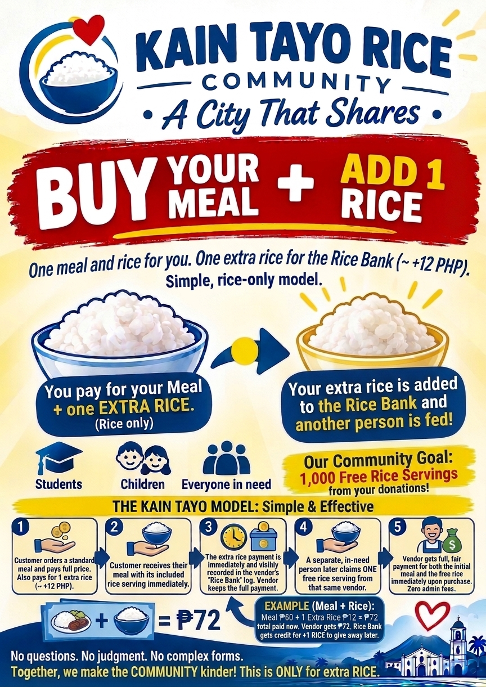
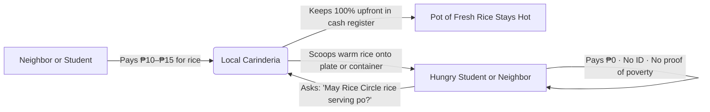

# 🌾 Rice Circle Dumaguete | Kain Tayo

  

  <strong>BUY 1 + GIVE 1 · A City That Shares</strong> 
  <em>One for you. One for someone who needs it.</em>

  
  
  
  
  

---

## 🕊️ About the Project

**Rice Circle Dumaguete** (*Kain Tayo*) is an open, decentralized grassroots civic initiative in Dumaguete City, Negros Oriental, Philippines.

This is **not a commercial software product** — it is an open social movement, civic toolkit, and direct mutual-aid model designed to ensure that anyone in need can receive a hot serving of rice with zero judgment, zero bureaucracy, and complete dignity.

> [!IMPORTANT]
> ### 🍚 You Can Pay for Just a Cup of Rice (₱10–₱15)
> You do **not** need to buy an entire meal to participate. When you visit any local carinderia in Dumaguete, you can simply pay for an extra cup of rice (₱10–₱15). It stays in the vendor's pot for a university student, schoolchild, or neighbor having a hard day.

---

## 🔗 Project Links & Web Pages

| Resource | Direct Link | Purpose |
| :--- | :--- | :--- |
| 🐙 **GitHub Repository** | [github.com/neuromicon/Kain-Tayo](https://github.com/neuromicon/Kain-Tayo) | Official open-source civic repository |
| 🌐 **GitHub Pages Site** | [neuromicon.github.io/Kain-Tayo](https://neuromicon.github.io/Kain-Tayo/) | Public hosted project portal |
| ⚡ **Live Companion App** | [ais-pre-dumaguete.run.app](https://ais-pre-4pysrudxpdm5d5etqjrzww-982954866356.asia-southeast1.run.app) | Interactive web platform & partner directory |
| 📋 **Partner Eatery Sign-Up** | [Google Forms Application](https://forms.gle/v6x6HVLLgUudt7fC8) | Free 2-minute carinderia enrollment |
| ✉️ **Organizer Contact** | [Neuromicon@gmail.com](mailto:Neuromicon@gmail.com) | Direct questions, inquiries, and coordination |

---

## 💡 How the Community Model Works

1. **Pay for Just a Cup of Rice (₱10–₱15):**  
   Add a cup of rice to your own lunch order, or step up to the counter just to pay for rice. No viand required.
2. **The Pot Stays Full:**  
   The cook keeps 100% of the cash immediately in their own drawer. No deductions, no commission, no middlemen.
3. **Claimed With Dignity:**  
   Anyone who is hungry asks for a Rice Circle serving. The cook serves freshly steamed rice. **No questions asked. Recipient pays ₱0.**

---

## 🏬 For Carinderias: 2-Minute Onboarding

Food vendors do not need any smartphones, apps, or accounting skills:

1. **Sign Up:** Submit the [Google Partner Form](https://forms.gle/v6x6HVLLgUudt7fC8) (or email [Neuromicon@gmail.com](mailto:Neuromicon@gmail.com)).
2. **Print 1 Page:** Print the [Counter Display Sign (PDF)](public/assets/aistudio/Kain_Tayo_Printable_Toolkit_654d1884.pdf).
3. **Display at Your Cash Register:**  
   - When a customer pays +₱10–₱15 for rice, keep the cash.
   - When someone in need asks for rice, scoop warm rice from your standard pot.

---

## 🖨️ Printable Toolkit & Open Materials

Everything in this repository is ready to print on standard A4 or US Letter paper:

- 📄 **[Printable Toolkit Pack (PDF)](public/assets/aistudio/Kain_Tayo_Printable_Toolkit_654d1884.pdf)** — 4-page ready-to-print packet:
  - Page 1: Public Eatery Poster (A4)
  - Page 2: Counter Display Table Tent / Sign
  - Page 3: Daily Physical Vendor Tally Ledger
  - Page 4: 6-Step City Pilot Launch Checklist
- 🖼️ **[Official Illustrated Poster (PNG)](public/assets/aistudio/Rice_Circle__Dumaguete_Shares_Kindness_487e773d.png)** — High-resolution artwork featuring Dumaguete landmarks.
- 🖼️ **[Cash Counter Display Sign (PNG)](public/assets/aistudio/Print_it.png)** — Ready-to-print counter graphic explaining the 5-step rice bank process.
- 📑 **[Vendor Agreement Template (MD)](docs/VENDOR_AGREEMENT.md)** — Transparent operational agreement for carinderia partnerships.
- 🚀 **[Start in Your City Playbook (MD)](docs/START_IN_YOUR_CITY.md)** — Complete 30-day guide to replicate the model in Bacolod, Valencia, Cebu, or any municipality.
- 📊 **[Daily Vendor Tally Guide (MD)](docs/DAILY_TALLY_GUIDE.md)** — Guide to running the simple paper counter sheet.

---

## 🛡️ Non-Negotiable Civic Principles

- **No Proof of Poverty:** No government ID cards, no income screening, no interviews.
- **Zero Stigma:** No separate lines, no photography of recipients, no humiliation.
- **100% Direct to Local Cooks:** No NGO overhead, no transaction cuts. Every peso goes to local family-run eateries.
- **Honest Mutual Aid:** We do not track or count people. We trust the simple bond between neighbor and cook.

---

## 🤝 Contact & City Coordination

- **GitHub Repository:** [https://github.com/neuromicon/Kain-Tayo](https://github.com/neuromicon/Kain-Tayo)
- **Partner Sign-Up Form:** [https://forms.gle/v6x6HVLLgUudt7fC8](https://forms.gle/v6x6HVLLgUudt7fC8)
- **Email Contact:** [Neuromicon@gmail.com](mailto:Neuromicon@gmail.com)
- **Pilot Location:** Dumaguete City, Negros Oriental, Philippines

---

## 📜 Public Domain Dedication

This open civic project is dedicated to the public domain under the [Creative Commons Zero (CC0 1.0 Universal)](LICENSE). Anyone is freely encouraged to clone, print, share, modify, and translate these materials for their own community without seeking permission.

*Padayon Dumaguete — A City That Shares.*
